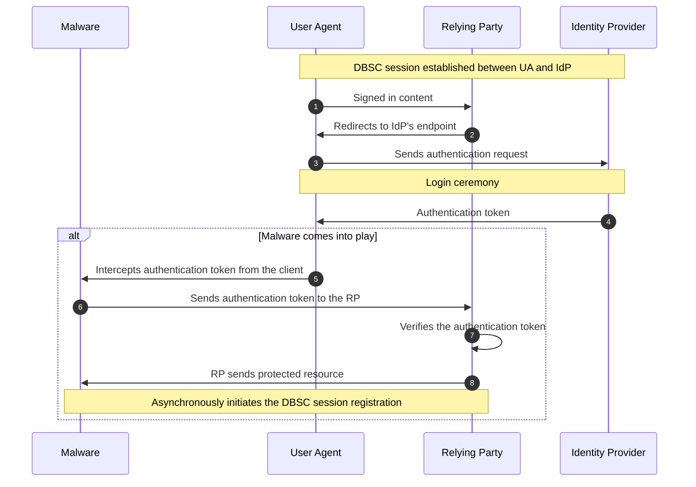
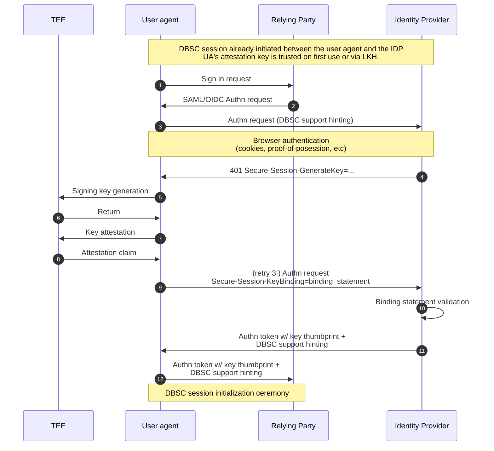
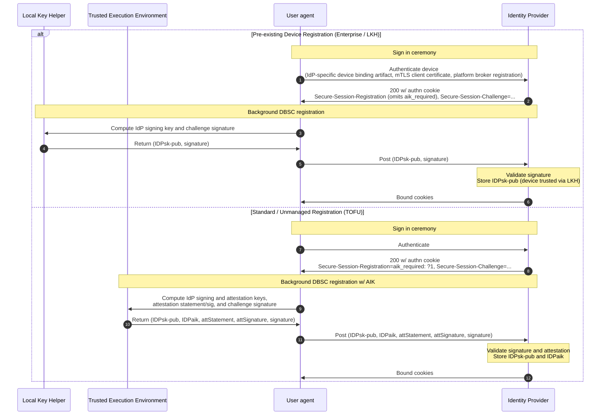
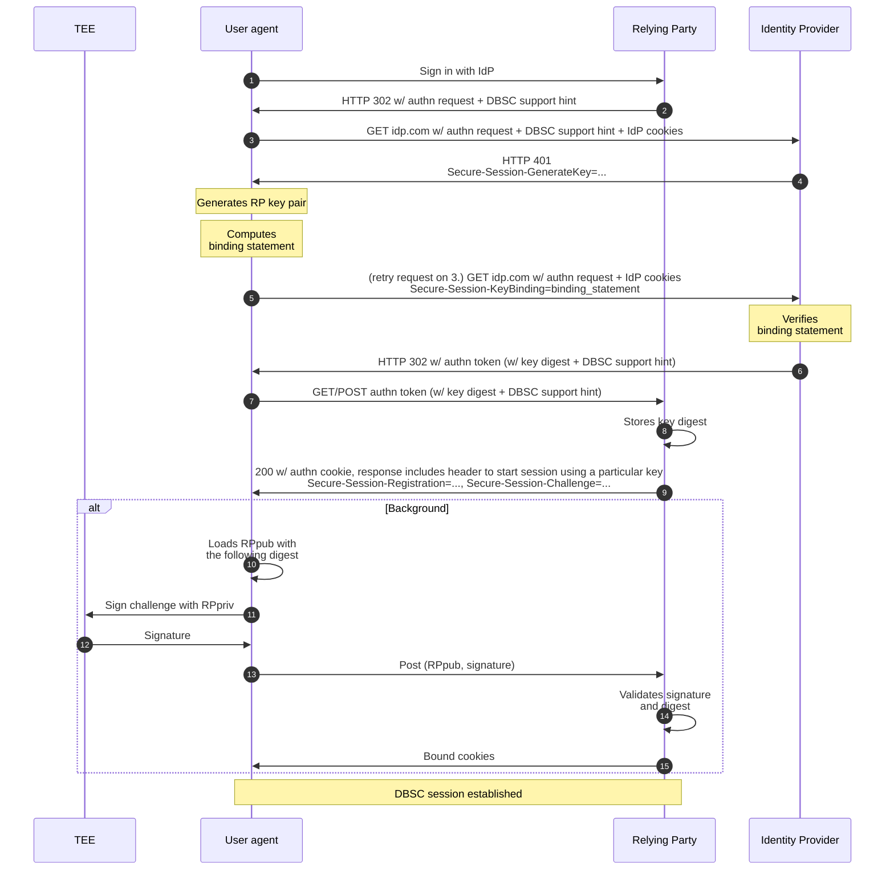

# Device Bound Session Credentials for SSO Explainer

## Authors

* [Lucas Santos](https://github.com/lucasrsant), Google
* [Daniel Margolis](), Google
* [Daniel Rubery](), Google
* [Alex Ilin](), Google
* [Rob Starling](), Google

## Contributors

* [Arnar Birgisson](https://github.com/arnar), Google
* [Jan Wilken Dörrie](https://github.com/jdoerrie), Google
* [Veena Soman](https://github.com/Veena11), Microsoft

## Participate

[Issue tracker](https://github.com/w3c/webappsec-dbsc/issues)

## Table of Content

<!-- START doctoc generated TOC please keep comment here to allow auto update -->
<!-- DON'T EDIT THIS SECTION, INSTEAD RE-RUN doctoc TO UPDATE -->

- [Introduction](#introduction)
- [Terminology](#terminology)
- [Relationship to DBSC(E) and Convergence](#relationship-to-dbsce-and-convergence)
- [Attack vector in depth](#attack-vector-in-depth)
- [High-level design](#high-level-design)
  - [Identity Provider's session initialization](#identity-providers-session-initialization)
  - [Relying Party's session initialization](#relying-partys-session-initialization)
  - [Session refresh](#session-refresh)
  - [Key access control and lifecycle](#key-access-control-and-lifecycle)
- [Component-level design](#component-level-design)
  - [Relying Party](#relying-party)
    - [SAML Assertion and OIDC Tokens](#saml-assertion-and-oidc-tokens)
    - [Key storage](#key-storage)
    - [DBSC session registration](#dbsc-session-registration)
  - [Identity Provider](#identity-provider)
    - [DBSC registration header](#dbsc-registration-header)
    - [Registration statement validation](#registration-statement-validation)
    - [Public and attestation keys storage](#public-and-attestation-keys-storage)
    - [User consent for key sharing](#user-consent-for-key-sharing)
    - [DBSC Key generation header](#dbsc-key-generation-header)
    - [Binding statement validation](#binding-statement-validation)
    - [SAML Assertions and OIDC tokens](#saml-assertions-and-oidc-tokens)
  - [User agent](#user-agent)
    - [Identity Provider registration statement](#identity-provider-registration-statement)
  - [Delegated key generation](#delegated-key-generation)
    - [Native Local Key Helper (LKH) Integration](#native-local-key-helper-lkh-integration)
  - [Identity Provider binding statement](#identity-provider-binding-statement)
  - [Relying Party's session initialization](#relying-partys-session-initialization-1)
- [Alternatives Considered](#alternatives-considered)
  - [Relayed refreshes](#relayed-refreshes)
  - [IdP's key sharing](#idps-key-sharing)
  - [Sync vs Async key generation](#sync-vs-async-key-generation)
- [Privacy considerations](#privacy-considerations)

<!-- END doctoc generated TOC please keep comment here to allow auto update -->

## Introduction

Cookie theft has emerged as a highly effective method for compromising user accounts, surpassing credential theft (passwords) in efficacy due to intensified efforts to strengthen password-based security (e.g., 2SV and passkeys).

As the existing DBSC protocol lacks support for cross-origin SSO authentication, it creates a significant attack surface. This vulnerability arises if either the IdP or the RP fail to perform periodic proof-of-possession for securely stored cryptographic keys.

Furthermore, even if both parties adopt DBSC, they cannot definitively prove that the two DBSC sessions are bound to the same physical device, which opens another vulnerability: malware with temporary device access can compel the IdP to grant a sign-in to the RP, subsequently binding the RP session to an attacker-owned private key.

Additionally, if malware is present during user's sign-in to the IdP, it can bind that session to its own key material, leading to a "session init attack" where the attacker takes over the session. While **DBSC for SSO does not directly mitigate this specific vulnerability**, it empowers the IdP to integrate complementary technologies, such as mTLS, to enhance protection.

In “normal” two-party DBSC we say that malware at sign-in time is out of scope. This is reasonable because sign-in on that model is inherently infrequent and noisy for the user. That limits the scalability of malware that has to wait for the sign in ceremony to make sense to the user.

On the other hand, traditional cookie-based authentication of an established session is very frequent (every request) and totally silent. So that is ripe for scaled infostealer malware.

The reason this proposal is valuable and needed is that SSO authentication is somewhere in the middle: It’s relatively frequent (e.g. daily) and mostly invisible to the user apart from maybe some quick redirects. Generally no user action is needed.

This document is inspired by the [DBSC(E) Explainer](https://github.com/w3c/webappsec-dbsc/blob/main/DBSCE/Overview.md) and extends it into a unified flow covering consumer scenarios in addition to enterprise.

## Terminology

*  **IdP:** The **Identity Provider** that the user authenticates with. It manages user’s credentials and issues SAML assertions to relying parties.
*  **RP:** Acronym for **Relying Party**; a web application that relies on IdP's assertion to allow users to access restricted content (referred to as "SP" or "Service Provider" in SAML docs).
*  **Session Provider:** In the context of the underlying [DBSC specification](https://w3c.github.io/webappsec-dbsc/#session-provider), a website or service that issues and maintains a user session. In this explainer, the Session Provider in the SSO flow is referred to as the **Identity Provider (IdP)**.
*  **TEE:** Acronym for **Trusted Execution Environment**; a secure, isolated area within a computer's main processor (CPU) that protects sensitive data and code from other parts of the system.
*  **AIK:** Acronym for **Attestation Identity Key.**
*  **Key material:** Asymmetric key pair hardware-backed (either by TPMs on PCs or Secure Enclaves on Mac devices).

* **LKH**: Acronym for **Local Key Helper**; an installed binary on enterprise managed devices that handles cryptographic operations and trust anchors.
## Relationship to DBSC(E) and Convergence

Both **DBSC for SSO** and **DBSC(E)** address malware threats that fall outside the threat model of base DBSC by cryptographically binding sessions across parties:

*   **DBSC for SSO** originally addressed **consumer scenarios** with unmanaged devices, securing the hand-off between an Identity Provider (IdP) and a Relying Party (RP). It prevents attackers from using exfiltrated IdP authentication tokens on different devices by ensuring the RP session key is attested to reside on the same device as the IdP session, typically establishing initial trust on first use (TOFU).
*   **DBSC(E)** addressed **enterprise scenarios** with managed devices, relying on a **"clean room" device registration** where the device is pre-provisioned and trusted by the enterprise. It introduced delegation to a "Local Key Helper" (such as OS identity brokers) to enforce binding against trusted device keys.

Rather than maintaining separate specifications and browser code paths, the two designs converge into a unified flow. A single protocol mechanism handles both consumer (TOFU) and enterprise (clean room) trust anchors: enterprise IdPs that already have established device trust establish a standard DBSC session without requesting an attestation key (`aik_required` omitted) and route subsequent RP key attestation through native platform Local Key Helper, while consumer IdPs follow the browser-native TOFU path with an attestation key.

## Attack vector in depth

Relying parties (RP) that adopt DBSC protect their users against cookie theft as they periodically ask for proof-of-possession in order to issue fresh authentication cookies. However, those who adopt Single Sign On (SSO) are still vulnerable to this kind of attack, even if both the RP and the Identity Provider (IdP) adopt DBSC. The vulnerability is particularly subtle when both RP and IDP implement DBSC because malware can **silently** circumvent the security measures.

In this attack, the malicious software intercepts an authentication token from the IdP and uses it to establish a new RP session.

Consequently, the session becomes tied to distinct keys, controlled by the attacker. Neither the RP nor the IdP can detect this malicious activity, as both sessions appear legitimate and are successfully bound.

This attack vector does not require any user interaction, hence can be automated in the background, and built into popular infostealers. It also does not require the infostealer to keep persistent presence on the infected user device, but
only at the time of issuing new RP authentication cookies.

The following diagram shows when the malware comes into action:


Malicious software intercepts IdP's authentication token and issues a new RP session bound to its own keys, bypassing IdP's binding

## High-level design

The DBSC support for SSO authentication cryptographically links both IdP and RP keys, so that even if malware is able to trick the IdP to give the attacker an authentication token, this token becomes unusable if exfiltrated from the device that originally created the IdP session.

This is because the device will need to, at RP-session refresh time, prove possession of a signing key that is trusted by the IdP, which in case of an IdP's cookie exfiltration will not be possible.

The device creates a new signing key for every RP the user is signing in to, and the underlying IdP is responsible for making sure the key was generated in the same device that originally signed in to the IdP.

Key attestation gives remote parties the ability to attest that a particular object is loaded in the same TEE, hence proving that both `IdPKey` and `RPKey` come from the same device.

The following diagram shows the overall SSO authentication flow and how the key presented by the User Agent is attested to be owned by the expected device:


Overview of the Single Sign-On authentication flow.

As stated in the diagram's first note, it's expected that a DBSC session between the device and the IdP is previously established. In the IdP's session initialization the user agent also sends an attestation key to the Identity Provider.

It is also expected that the IdP adopts a [TOFU](https://en.wikipedia.org/wiki/Trust_on_first_use) approach and trusts the attestation key as soon as it is presented at sign in time. Although this might represent an attack vector, IdPs can also improve their session initialization mechanism (e.g. by adopting security keys) so that they can make sure the attestation key comes from a trusted device. Such additional mechanisms are out of scope of this proposal.

**The above high level diagram is broken down as follows:**

* **Attestation key generation (consumer-only):** During the session initialization between the device and the IdP, the device creates an AIK (Attestation Identity Key) and sends it to the IdP, which stores it for future RP signing keys attestation verification.

	Mac devices do not support such an attestation capability, so an extra key pair is generated by the browser and provided to the Identity Provider (IdP) during sign-in to serve as such. This offers minimal security benefit currently as malicious software could inject its own RP key to be signed by the Secure Enclave. However, this implementation is designed for future compatibility: it can be directly replaced with a genuine Attestation Identity Key (AIK) once Apple introduces support for such a capability.

	In addition to that, this model relies on Apple's code signing capabilities, which prevents software other than the one that created a particular Secure Enclave-protected key to access (and hence use) it.

* **Sign in request:** The user navigates to an authentication-protected resource in the RP. If the user has visited that page before, generally the RP automatically redirects the user to the Identity Provider (seamless authentication), otherwise the user clicks on “Sign in With …” (interactive authentication), which generates an authentication request that is forwarded to the IdP, typically via an HTTP redirect.

* **Browser authentication:** The IdP checks the browser authentication. This can be done either via authentication cookie presence or re-validating the proof-of-possession.

* **Identity Provider asks the browser to generate a new key:** If the IdP detects a bound session for that browser when receiving the authentication request, it then returns an **HTTP 401** with the `Secure-Session-GenerateKey` header. The header indicates that either the browser or local key helper (LKH) must generate a new signing key for the underlying RP, and includes the `provider_session_id` identifying the IdP session whose attestation key (AIK) or LKH will be used to attest the new key.

	When the browser sees the `Secure-Session-GenerateKey` header, it must check if the issuing request can set a cookie bound to the IdP's session, otherwise it fails the operation.

	The new signing key must be tied to the Relying Party's [origin](https://developer.mozilla.org/en-US/docs/Glossary/Origin) by the browser. This serves as a protection mechanism against malicious RPs trying to *guess* unique hardware-backed identifiers. The user agent only shares the public key material with the RP that is supposed to have access to it.

	The key access control model is discussed in detail [further](#key-access-control-and-lifecycle) in this document.

* **Signing key generation:** This step relies on securely-stored keys generation, which can be either on TPMs (Windows and Linux), Secure Enclave (macOS), or secure storage chosen by an enterprise LKHs. Browser-managed keys are the same as in standard DSBC. The user agent treats a LKH-based key as an opaque key handle.

* **Browser sends the key digest to the IdP:** When the browser finishes computing the binding statement, it retries the request that triggered the key generation, appending the new header `Secure-Session-KeyBinding` carrying the statement.

	This permits the SSO authentication process to continue normally.

* **Authentication tokens:** Upon a valid binding statement presented, the IdP issues its regular authentication token (SAML assertion or OIDC Tokens) to the RP, which now includes the signing key digest (or certificate fingerprint) that should be trusted by the RP. If the authentication token is legit (signed by the IdP), the RP can trust the public key (or client certificate) that matches the specified digest.

	On OIDC flows, the key digest is included in the OIDC token, which is sent via backchannel communication between the RP and the IdP.

* **RP session initialization:** RPs can issue authentication cookies bound to the key (or certificate) trusted by the IdP immediately, and then return the `Secure-Session-Registration` header to start the binding process on the User Agent side. The header must include the `provider_key` parameter to indicate the expected key digest (or certificate fingerprint).

	RPs should not issue unbound long-lived cookies, otherwise the session would not be protected.

* **Relying Party and Identity Provider DBSC support hinting:** In consumer IdP scenarios, the Relying Party should hint the Identity Provider whether it supports DBSC. This is to avoid the browser being unnecessarily asked to generate signing key and attestation statement, as the RP will very likely ignore this information if it does not support it.

	As authentication requests can be spoofed, malware can fake support absence to induce the Identity Provider not to send a trusted key digest back to the RP, which would lead the RP not to start a bound session, or fallback to standard DBSC.

	To circumvent this, the IdP should also hint the RP back in its **signed** response (in the SAML Assertion or OIDC Token), so that if the RP supports DBSC and does not get a trusted key digest (or certificate fingerprint) in the assertion, it's a strong signal that the authentication request has been tampered with.

	In Enterprise scenarios, Identity Providers can hold additional configurations in which Admins can state that a particular Relying Party supports DBSC-SSO, or even further; that the IdP should only issue an assertion if the device succesfully generates a binding statement.


### Identity Provider's session initialization

Initializing the session with an Identity Provider has some extra steps in comparison to the standard DBSC. The attestation key is additional information required to later attest that new RP signing keys reside in the same device that the IdP has a bound session.

Depending on the device management state and trust model, session initialization follows one of two paths:

1. **Pre-existing Device Registration (Clean-Room / Enterprise):** When the IdP can authenticate the device through an existing device trust relationship (such as a DeviceKey-signed Primary Refresh Token, client certificate over mTLS, or platform broker registration), the IdP establishes a standard DBSC session via `Secure-Session-Registration` but **omits the `aik_required` parameter**. Since the device is already trusted and registered with its own trust anchor validated by the Local Key Helper (LKH), there is no need for the browser to generate and register a new attestation identity key (AIK) with the IdP. The existing device trust anchor is leveraged by the LKH to attest subsequent Relying Party keys. IdPs without device trust **MUST** use TOFU.
2. **Standard / Unmanaged Registration (TOFU):** When no pre-existing device registration exists, the IdP triggers session registration and includes the boolean parameter `aik_required: ?1` in the `Secure-Session-Registration` header, indicating that the client should generate and provide an Attestation Key in addition to the regular signing key.

The following diagram shows how a bound session is established between the User Agent and the IdP:


Identity Provider session binding flow.

Each step in the diagram is detailed below:

**Sign in ceremony:**
* **Pre-existing Device Registration (Enterprise):** The User Agent authenticates the device using existing selected mechanism (mTLS client certificate, platform broker registration, IdP-specific device binding artifact). Upon successful authentication, the IdP responds with `Secure-Session-Registration` omitting `aik_required`, initiating standard DBSC session registration.
* **Standard / Unmanaged Registration (TOFU):** The sign-in ceremony proceeds normally. Upon successful authentication, the IdP includes the `aik_required: ?1` parameter in the `Secure-Session-Registration` header, signaling that the client **must** provide cryptographic proof of the relationship between the session signing key and a newly generated attestation key.

**Key generation and attestation:** This step is performed asynchronously in the background:
* In the **Enterprise / LKH** path, the trigger for using the Local Key Helper is the presence of an authorized LKH mapping configured for the IdP origin. When this mapping is detected, the browser delegates **all** cryptographic operations for the session to the LKH so that browser-managed and LKH-managed keys are never mixed on the same session: the **LKH** creates the session signing key pair $(IdP_\text{sk-pub}, IdP_\text{sk-priv})$, retains $IdP_\text{sk-priv}$ (returning an opaque key handle to the browser), and signs the challenge sent by the server. Because the device is already trusted and its trust anchor is managed by the LKH, no browser-managed attestation identity key (AIK) is generated or registered (even if `aik_required` were present).
* In the **Consumer / TOFU** path (when no LKH is mapped to the IdP origin and `aik_required: ?1` is present), the browser creates both signing and attestation keys in the TEE:
	1. A new signing key pair $(IdP_\text{sk-pub}, IdP_\text{sk-priv})$ is created. $IdP_\text{sk-pub}$ is used to register the IdP DBSC session.
	1. The challenge sent by the server is signed with $IdP_\text{sk-priv}$.
	1. A new attestation key pair $(IdP_\text{ak-pub}, IdP_\text{ak-priv})$ is created and used to create an attestation claim for $IdP_\text{sk}$.

**Registration statement:** On the enterprise path, the client sends a standard [DBSC proof](https://w3c.github.io/webappsec-dbsc/#format-jwt) containing only the session signing key. On the TOFU path, a new variant of the DBSC proof takes place to accommodate both subject and attestation keys. It uses [nested JWT](https://www.rfc-editor.org/rfc/rfc7519#appendix-A.2) so the subject key is the payload of the encompassing attestation key, expressed in the [JWS](https://www.rfc-editor.org/rfc/rfc7515) format:

```json5
// Header
{
	"alg": "ES256",
	"typ": "dbsc+aik",
	"cty": "jwt", // Indicates nested JWT
	"jwk": { // Holds the attestation public key material.
		"kty": "EC",
		"crv": "P-256",
		"x": "...",
		"y": "..."
	}
}

// Payload
{
	"aud": "https://idp.com/reg",
	"jti": "Base64URL encoded JWT representing the DBSC proof as specified at https://w3c.github.io/webappsec-dbsc/#format-jwt",
	"att": "Base64URL encoded JSON object defined below."
}
```

The attestation statement format is defined as follows depending on `fmt`. IdP session registration and RP session binding use the same attestation construction; they differ in the subject key being certified ($IdP_\text{sk-pub}$ vs. $RP_\text{sk-pub}$), in the corresponding server challenge, and in which fields are carried on the wire — the registration statement below declares `alg` and `fmt`, while the [binding statement](#relying-partys-session-initialization) omits both because by then the IdP holds them as stored session state:

For `TPM`:

```json5
{
  "fmt": "TPM",
  "alg": "ES256|RS256",
  "stmt": "Base64URL encoded TPMS_ATTEST structure",
  "sig": "Base64URL encoded TPMT_SIGNATURE structure",
  "sub_key": "Base64URL encoded TPMT_PUBLIC structure",
  // optional: container for enterprise/LKH-specific metadata (e.g. helper_id, binding_type). Not covered by `sig`.
  "extra_claims": { ... }
}
```

For `SECURE_ENCLAVE`:

```json5
{
	"fmt": "SECURE_ENCLAVE",
	"alg": "ES256",
	"stmt": "Base64URL encoded raw_stmt",
	"sig": "Base64URL encoded signature of raw_stmt",
	"sub_key": "Base64URL encoded SubjectPublicKeyInfo structure",
	// optional: container for enterprise/LKH-specific metadata (e.g. helper_id, binding_type). Not covered by `sig`.
	"extra_claims": { ... }
}
```

*  **fmt**: The format of the presented attestation statement (e.g., `TPM`, `SECURE_ENCLAVE`, or extensible local key helper formats such as `KEYGUARD`). The attestation format is decoupled from the host operating system. Any attestation format **MUST** ensure that the signed bytes in `stmt` cryptographically commit to both `hash(challenge, hash_alg(alg))` and `sub_key`, as both `TPM` and `SECURE_ENCLAVE` do. The IdP **MUST** store this value with the attestation key record; it is the value the [binding statement validation](#binding-statement-validation) branches on.
*  **alg**: The **signature** algorithm of the attestation signing key ($IdP_\text{ak}$), e.g., `ES256` or `RS256` — not a digest algorithm. The hash algorithm used for hashing the challenge and computing the subject key digest is written `hash_alg(alg)` and is derived from it (e.g. SHA-256 for `ES256`/`RS256`, SHA-384 for `ES384`). The IdP MUST store `alg` with the attestation key; the binding statement does not repeat it.
*  **stmt**: The attestation statement payload encoded in Base64URL:
   * If `fmt` is `TPM`, it is the [TPMS\_ATTEST](https://trustedcomputinggroup.org/wp-content/uploads/TPM-Rev-2.0-Part-2-Structures-01.38.pdf#page=126) object certifying `sub_key`, generated with `qualifyingData` set to the hashed challenge `hash(challenge, hash_alg(alg))`. Hashing the challenge ensures a fixed payload size across the hardware/enclave boundary.
   * If `fmt` is `SECURE_ENCLAVE`, it is `base64url_enc(raw_stmt)` where `raw_stmt` is the concatenation of the hashed challenge and the digest of the subject key as carried in `sub_key`:

```
// pseudo-code
c := hash(challenge, hash_alg(alg)) // hashed challenge
d := hash(sub_key_bytes, hash_alg(alg)) // digest over the DER SubjectPublicKeyInfo
raw_stmt := concat(c, d)
stmt := base64url_enc(raw_stmt)
```

*  **sig**: The attestation statement signature encoded in Base64URL. If `fmt` is set to `TPM`, the format of the signature is the [TPMT\_SIGNATURE](https://trustedcomputinggroup.org/wp-content/uploads/TPM-Rev-2.0-Part-2-Structures-01.38.pdf#page=144) object. If `fmt` is set to `SECURE_ENCLAVE`, then it is the ECDSA signature over `raw_stmt` signed using $IdP_\text{ak-priv}$, formatted as a raw IEEE P1363 signature ($r \parallel s$, fixed 64 bytes for P-256 / ES256 per [RFC 7518 Section 3.4](https://www.rfc-editor.org/rfc/rfc7518#section-3.4)), encoded in Base64URL.

	> **Platform Implementation Note (Apple platforms):** On Apple platforms, `SecKeyCreateSignature` produces an ASN.1 DER-encoded ECDSA signature (`kSecKeyAlgorithmECDSASignatureMessageX962SHA256`). Implementations (such as Chromium / User Agents) MUST convert this ASN.1 DER signature to the raw IEEE P1363 format ($r \parallel s$, fixed 64 bytes for P-256) before Base64URL encoding into `sig`.
*  **sub_key**: The Base64URL-encoded public key of the subject key being certified ($IdP_\text{sk-pub}$). The encoding is selected by `fmt`:
   * If `fmt` is `TPM`, it is the [TPMT\_PUBLIC](https://trustedcomputinggroup.org/wp-content/uploads/TPM-Rev-2.0-Part-2-Structures-01.38.pdf#page=151) structure.
   * If `fmt` is `SECURE_ENCLAVE`, it is the DER-encoded `SubjectPublicKeyInfo` ([RFC 5280 Section 4.1.2.7](https://www.rfc-editor.org/rfc/rfc5280#section-4.1.2.7)).

	The field is required for both formats. `stmt` only ever carries a *digest* of the subject key, so without `sub_key` the IdP cannot recover the key material itself, and it cannot re-derive that digest under any other encoding.
*  **extra_claims**: (Optional) A JSON object containing enterprise-specific contextual metadata (e.g., helper identifiers or binding semantics). This property is not covered by `sig`, thus if IdP needs to trust the values in it, their own LKH implementation should handle the signature.

**Server-side validation:** The server validates the registration statement and securely stores both the signing and attestation keys $(IdP_\text{pk}, IdP_\text{pak})$ public material. If valid, the server issues fresh (and bound) authentication cookies.

**Attestation key bypass:** Key attestation is used to generate per-RP keys and avoid re-using the same signing key as the IdP. This is mostly designed to prevent user tracking. However, under enterprise contexts, sharing the IdP key with multiple RPs might not pose a privacy concern, and should be allowed under certain circumstances (e.g. Enterprise browser policies) to increase adoption.

### Relying Party's session initialization

When starting an SSO flow, the RP should signal its DBSC support to the IdP. This prevents the IdP from unnecessarily requesting key generation if the RP doesn't support DBSC.

Since authentication requests can be tampered with (e.g., to hide DBSC support in a downgrade attack attempt), the RP should verify that the IdP's signed response confirms both its own DBSC support and the parameters received in the initial request. This allows the RP to detect if the request was modified to prevent a bound session from being established.

In Enterprise scenarios this hinting dance can be skipped entirely as Identity Providers (in general) hold additional per-RP configurations, and hence such support can be stored alongside these configurations.

Upon authentication request, the IdP instructs the User Agent to create a new key pair through an HTTP header (`Secure-Session-GenerateKey`). Once the new signing key is generated, the browser builds the binding statement and sends it to the IdP. Upon the binding statement and session validation, the IdP sends an authentication code back to the RP containing the signing key's digest that should be trusted.

The binding statement uses the same attestation construction as the registration statement described above, with the per-RP key ($RP_\text{sk-pub}$) as the certified subject key and the binding challenge from `Secure-Session-GenerateKey` as the challenge. It differs in one respect: it does **not** carry `alg` or `fmt`.

Both values are established out-of-band relative to the binding statement:
* On the **consumer / unmanaged (TOFU) path**, they were established and signed when the browser's attestation key was registered, so the IdP holds them in the user session state loaded alongside $IdP_\text{ak-pub}$.
* On the **enterprise / clean-room path**, they were established during pre-existing device enrollment, so the IdP loads them from its enterprise device registry (matching the authenticated device identity) alongside the enterprise attestation/device public key.

Repeating them on the binding statement would make them attacker-controlled inputs that every IdP would have to remember to pin against the stored record; a missing pin passes every test a conforming browser generates and fails only under attack. Omitting them makes the stored/pinned record the sole source, preventing format-confusion attacks across both trust models.

> **Invariant:** The verification key ($IdP_\text{ak-pub}$ or pre-registered enterprise device key), the algorithm `alg`, and the attestation format `fmt` MUST all come from stored state — either from the session state stored at AIK registration (consumer TOFU path) or from the IdP's pre-existing device registration records (enterprise clean-room path). The binding statement never carries `alg` or `fmt`. Everywhere `hash_alg(alg)` appears in the binding path below, `alg` is the stored/pinned algorithm, never a value read from the statement.

This asymmetry with the registration statement is deliberate. At registration the two values are covered by the signature and the IdP has no prior state to compare them against; at binding time they would be unauthenticated and fully redundant. If key transport (`x5c` or `jwk`) is ever added to the binding statement, the reasoning no longer holds and both fields must move back in, inside the signed bytes.

For `TPM`:

```json5
{
	"stmt": "Base64URL encoded TPMS_ATTEST structure",
	"sig": "Base64URL encoded TPMT_SIGNATURE structure",
	"sub_key": "Base64URL encoded TPMT_PUBLIC structure",
	"extra_claims": { // Optional: platform or broker metadata. Not covered by `sig`.
		// e.g., "helper_id", "binding_type"
	}
}
```

For `SECURE_ENCLAVE`:

```json5
{
	"stmt": "Base64URL encoded raw_stmt",
	"sig": "Base64URL encoded signature of raw_stmt",
	"sub_key": "Base64URL encoded SubjectPublicKeyInfo structure",
	"extra_claims": { // Optional: platform or broker metadata. Not covered by `sig`.
		// e.g., "helper_id", "binding_type", "attestation_format"
	}
}
```

*  **stmt**: The attestation statement payload encoded in Base64URL:
   * If the stored `fmt` is `TPM`, it is the [TPMS\_ATTEST](https://trustedcomputinggroup.org/wp-content/uploads/TPM-Rev-2.0-Part-2-Structures-01.38.pdf#page=126) structure certifying $RP_\text{sk}$, generated with `qualifyingData` set to `hash(challenge, hash_alg(alg))`.
   * If the stored `fmt` is `SECURE_ENCLAVE`, it is `base64url_enc(raw_stmt)` where `raw_stmt` is the concatenation of the hashed challenge and the digest of the subject key as carried in `sub_key`:

```
// pseudo-code
c := hash(challenge, hash_alg(alg)) // hashed challenge
d := hash(sub_key_bytes, hash_alg(alg)) // digest over the DER SubjectPublicKeyInfo
raw_stmt := concat(c, d)
stmt := base64url_enc(raw_stmt)
```

*  **sig**: The signature encoded in Base64URL:
   * If the stored `fmt` is `TPM`, it is the [TPMT\_SIGNATURE](https://trustedcomputinggroup.org/wp-content/uploads/TPM-Rev-2.0-Part-2-Structures-01.38.pdf#page=144) structure defined in the TPM 2.0 specs.
   * If the stored `fmt` is `SECURE_ENCLAVE`, it is the ECDSA signature over `raw_stmt` signed using $IdP_\text{ak-priv}$, formatted as a raw IEEE P1363 signature ($r \parallel s$, fixed 64 bytes for P-256 / ES256 per [RFC 7518 Section 3.4](https://www.rfc-editor.org/rfc/rfc7518#section-3.4)), encoded in Base64URL. On Apple platforms, user agents MUST convert the ASN.1 DER signature from `SecKeyCreateSignature` to the raw IEEE P1363 format ($r \parallel s$, fixed 64 bytes for P-256) before Base64URL encoding into `sig`. Unlike `TPMT_SIGNATURE`, this encoding carries no algorithm identifier, so the stored AIK record is what tells the IdP how to *decode* it, not merely how to verify it.
*  **sub_key**: The Base64URL-encoded public key of the per-RP key ($RP_\text{sk-pub}$). The encoding is selected by the stored `fmt`:
   * If the stored `fmt` is `TPM`, it is the [TPMT\_PUBLIC](https://trustedcomputinggroup.org/wp-content/uploads/TPM-Rev-2.0-Part-2-Structures-01.38.pdf#page=151) structure.
   * If the stored `fmt` is `SECURE_ENCLAVE`, it is the DER-encoded `SubjectPublicKeyInfo` ([RFC 5280 Section 4.1.2.7](https://www.rfc-editor.org/rfc/rfc5280#section-4.1.2.7)).

	The field is required for both formats. The IdP has to forward a trusted key digest to the RP (`dbsc_trusted_key_digest` in OIDC, `<dbsc:TrustedKey digest="...">` in SAML), and that digest is computed over the canonical JWK of $RP_\text{sk-pub}$ ([RFC 7638](https://www.rfc-editor.org/rfc/rfc7638)) — a different encoding from the one hashed into `raw_stmt`. The IdP therefore needs the key itself, not just a digest of it.
*  **extra_claims**: (Optional) A JSON object containing enterprise-specific contextual metadata (e.g. `helper_id`, `binding_type`, or attestation policies). This property is not covered by `sig`, thus if IdP needs to trust the values in it, their own LKH implementation should handle the signature.

The following diagram shows how a new DBSC session is established between the device and the RP on top of a trusted key digest:


DBSC session initialization with a trusted key digest

Before establishing the session, the RP should evaluate the following scenarios:

* If the Relying Party **does not** support DBSC, then it proceeds as is.
* If the Relying Party **does** support DBSC, then it should evaluate:
	* If the signed IdP response contains the **same parameters initially sent by the RP and a trusted key digest**, then it should proceed with session establishment.
	* If the signed IdP response contains the **initial parameters but lacks a trusted key**, it means that the IdP failed to assert any signing key. Detailed error messages may or may not be in the IdP response.
	* If the signed IdP response **does not contain the initial parameters**, it's a strong indicator that the authentication request has been tampered with and this can be part of a downgrade attack.

The Relying Party indicates what key should be used in the parameter `provider_key` set in the `Secure-Session-Registration` header.

The value for this parameter is the key digest sent by the IdP. The browser will send the public key material only if all the following criterias match:

* RP's origin matches the origin indicated by the Identity Provider in the `target_origin` parameter of the `Secure-Session-GenerateKey` header.
* The `provider_key` parameter matches the underlying key digest, treated as an opaque string.

Once the existing key is sent to the RP, the session registration flow happens in the same way as the standard DBSC.

### Session refresh

Both IdP and RP sessions are standard DBSC sessions, and upon authentication cookie expiration, the User Agent performs the proof-of-possession required in the refresh process. For browser-managed keys, the User Agent signs the refresh challenge using the locally stored private key. For keys provisioned via a Native Local Key Helper (LKH), the User Agent delegates proof-of-possession signature generation to the LKH using the stored key handle. No additional protocol steps or backchannels are required.

### Key access control and lifecycle

When the Identity Provider instructs the User Agent to generate a new signing key via the `Secure-Session-GenerateKey` header, the User Agent stores an opaque key handle / `KeyId`  and associates it with the following metadata:

*  **Target Origin:** The [origin](https://developer.mozilla.org/en-US/docs/Glossary/Origin) specified in the `target_origin` parameter, which is the RP origin.

* **Key Provider**: Whether the key is browser- or LKH-managed. In case of the latter, which LKH owns this key, as a device can have multiple ones.

Note: Because keys are scoped to origins, distinct subdomains naturally receive distinct keys. If an RP wants to keep separate keys on the same origin, it's up to them to use separate [session IDs](https://w3c.github.io/webappsec-dbsc/#device-bound-session-session-identifier) so that browsers do not overwrite keys.

This metadata enforces a strict access control policy: the User Agent **must** only prove possession of this specific key to the Relying Party if:

1. The Relying Party identifies the key by its digest (via the `provider_key` parameter in the `Secure-Session-Registration` header).

1. The Relying Party's origin matches the stored **Target Origin**.

By relying on the key digest as the primary identifier, the User Agent allows multiple keys to exist for the same **Target Origin**. This prevents key collisions in scenarios where an Identity Provider manages multiple tenants or sessions for the same Relying Party, ensuring that the correct key is always selected based on the unique fingerprint provided by the RP.

When browsing data, cookies, or credentials for the Relying Party origin are cleared by the user or per browser storage clearing policies, the User Agent deletes the stored key material (and, in the case of keys managed via a Native Local Key Helper, instructs the LKH to delete the associated key handle).

## Component-level design

In this section we dive deep into each of the involved components and detail what capabilities they support to enable cross-origin DBSC.

### Relying Party

Besides the [standard DBSC implementation](https://developer.chrome.com/docs/web-platform/device-bound-session-credentials), the RP also needs to perform the following changes to support it on SSO flows:

#### SAML Assertion and OIDC Tokens

The Identity Provider shares the trusted public key's digest (for TPM-bound sessions) or the certificate fingerprint (for mTLS-bound sessions) and the algorithm utilized (SHA-256|384|512) with the Relying Party via either SAML Assertion or OIDC Tokens, depending on which SSO protocol the RP is using.

While DBSC primarily focuses on TPM-bound keys, it also supports certificate-based binding (e.g., via mTLS) to accommodate platforms or scenarios where hardware-backed keys might not be available or as an additional layer of security. In such cases, the IdP can share the client certificate's fingerprint instead of, or in addition to, the public key digest.

Note: Sharing certificate fingerprints can pose privacy concerns as they may serve as a persistent identifier across different Relying Parties. While this is generally acceptable in enterprise scenarios where device tracking and security auditing are required, it should be carefully considered for consumer use cases.

In case of SAML, the trusted key's digest and `digest_alg` (or the certificate fingerprint and its algorithm) are returned in a `saml:Advice` tag using either `<dbsc:TrustedKey>` or `<dbsc:TrustedCertificate>`, as in the following example:

```xml
<samlp:Response>
	<saml:Assertion>
		<saml:Advice>
			<dbsc:TrustedKey xmlns:dbsc="https://www.w3.org/NS/DBSC"
				digest="nZgxCylNy7jXvn4+j0DykE+TDK4W41LTffxei29e/G0="
				digest_alg="SHA-256"/>
			<dbsc:TrustedCertificate xmlns:dbsc="https://www.w3.org/NS/DBSC"
				fingerprint="f3e9619a9d701a52701469e4f83d32847b2374e2593f66d48b788647097c234b"
				fingerprint_alg="SHA-256"/>
		</saml:Advice>
	</saml:Assertion>
</samlp:Response>
```

The XML Schema Definition for these elements is defined as follows:

```xml
<?xml version="1.0" encoding="UTF-8"?>
	<xs:schema xmlns:xs="http://www.w3.org/2001/XMLSchema" targetNamespace="https://www.w3.org/NS/DBSC" xmlns:dbsc="https://www.w3.org/NS/DBSC" elementFormDefault="qualified">
		<xs:simpleType name="DigestAlgorithmType">
			<xs:restriction base="xs:string">
				<xs:enumeration value="SHA-256"/>
				<xs:enumeration value="SHA-384"/>
				<xs:enumeration value="SHA-512"/>
			</xs:restriction>
		</xs:simpleType>
		<xs:simpleType name="DigestType">
			<xs:union memberTypes="xs:base64Binary xs:string"/>
		</xs:simpleType>
		<xs:simpleType name="FingerprintType">
			<xs:union memberTypes="xs:hexBinary xs:string"/>
		</xs:simpleType>
	<xs:element name="TrustedKey">
		<xs:complexType>
			<xs:attribute name="digest" type="dbsc:DigestType" use="required">
			<!-- documentation omitted for brevity -->
			</xs:attribute>
			<xs:attribute name="digest_alg" type="dbsc:DigestAlgorithmType" use="required">
			<!-- documentation omitted for brevity -->
			</xs:attribute>
		</xs:complexType>
	</xs:element>
	<xs:element name="TrustedCertificate">
		<xs:complexType>
			<xs:attribute name="fingerprint" type="dbsc:FingerprintType" use="required">
			<!-- documentation omitted for brevity -->
			</xs:attribute>
			<xs:attribute name="fingerprint_alg" type="dbsc:DigestAlgorithmType" use="required">
			<!-- documentation omitted for brevity -->
			</xs:attribute>
		</xs:complexType>
	</xs:element>
</xs:schema>
```

Corresponding custom claims are present in the OIDC Token, as follows:

```json5
{
	"iss": "http://idp.com",
	...
	"dbsc_trusted_key_digest": "nZgxCylNy7jXvn4+j0DykE+TDK4W41LTffxei29e/G0=",
	"dbsc_trusted_key_digest_alg": "SHA-256|384|512",
	"dbsc_trusted_cert_fingerprint": "f3e9619a9d701a52701469e4f83d32847b2374e2593f66d48b788647097c234b",
	"dbsc_trusted_cert_fingerprint_alg": "SHA-256|384|512"
}
```

In OIDC implementations, the Discovery Document may be updated to indicate that `dbsc_trusted_key_digest` and `dbsc_trusted_key_digest_alg` (as well as `dbsc_trusted_cert_fingerprint` and `dbsc_trusted_cert_fingerprint_alg` for certificate-bound sessions) are supported claims.

#### Key storage

As the DBSC session registration is done asynchronously, the RP needs to keep track of the trusted digest sent in the authentication token, so that when the User Agent presents its key, the RP is able to compare its digest with the trusted one.

#### DBSC session registration

In the RP's DBSC session registration, the parameter `provider_key` must be sent in the `Secure-Session-Registration` header, which tells the browser what key the RP expects. To avoid any *guessing* capabilities for malicious RPs, the User Agent only sends the key if it was assigned to the RP's origin during its creation.

When the User Agent responds with the DBSC registration proof (in the `Secure-Session-Response` header as a JWS):

1. The RP extracts the public key (`jwk`) from the JWS header.
2. The RP computes the RFC 7638 JWK Thumbprint of the extracted `jwk` using the algorithm specified by the IdP (`dbsc_trusted_key_digest_alg` in OIDC or `digest_alg` in SAML).
3. The RP verifies that this computed JWK Thumbprint matches the trusted key digest received in the IdP's assertion or token (`dbsc_trusted_key_digest` in OIDC, or the `digest` attribute of `<dbsc:TrustedKey>` in SAML).
4. The RP verifies the JWS signature over the registration challenge to prove possession of the private key.

If both the JWK thumbprint verification and the signature verification succeed (or if certificate fingerprint verification succeeds for certificate-bound sessions), the RP establishes the bound session with the User Agent.

### Identity Provider

As shown in the first diagram of this document, it is expected that the IdP supports DBSC. So starting from this premise, the Identity Provider should implement the following:

#### DBSC registration header

When the user is signing in to the IdP, besides the standard DBSC headers, the `Secure-Session-Registration` header includes the new `aik_required` parameter.

This is a [boolean](https://datatracker.ietf.org/doc/html/rfc9651#name-booleans) parameter indicating whether the User Agent should create an attestation identity key.

#### Registration statement validation

The registration statement is the payload sent to the IdP when the user is signing in to it. It is composed of the following:

* IdP public signing key material - The $IdP_\text{sk-pub}$ is used to validate the challenge signature. This proves possession of the private counterpart ($IdP_\text{sk-priv}$) of the signing key.

* IdP attestation key - The $IdP_\text{ak-pub}$ is used to verify the attestation claim.

* Attestation claim - The attestation claim cryptographically proves the relationship between $IdP_\text{sk-priv}$ and $IdP_\text{ak-priv}$. In other words, it proves they are both stored in the same TEE if the platform allows it. If the platform does not have such a capability (e.g. macOS), this key just proves that both come from the same client, but they **might** not be stored in the same secure hardware.

* Challenge signature - This signature is used to prove $IdP_\text{sk-priv}$ possession, as previously mentioned.

To validate the registration statement, the IdP must do the following:

1. Verify the challenge signature using $IdP_\text{sk-pub}$.
1. Verify that `alg` matches the expected algorithm of $IdP_\text{ak-pub}$.
1. Verify the attestation statement according to `fmt`:
	* **`SECURE_ENCLAVE`**:
		1. Decode `stmt` from Base64URL to obtain `raw_stmt`.
		1. Verify that the first half of `raw_stmt` matches `hash(challenge, hash_alg(alg))`.
		1. Decode `sub_key` from Base64URL to obtain the DER `SubjectPublicKeyInfo` of the certified key, and verify that the second half of `raw_stmt` matches `hash(sub_key_bytes, hash_alg(alg))`.
		1. Verify that $IdP_\text{sk-pub}$ matches the public key parsed from `sub_key`.
		1. Decode `sig` from Base64URL and verify that the decoded signature is exactly 64 bytes in length (raw IEEE P1363 format $r \parallel s$, with 32 bytes for $r$ and 32 bytes for $s$).
		1. Verify the signature over `raw_stmt` using $IdP_\text{ak-pub}$ (converting the 64-byte raw IEEE P1363 $r \parallel s$ signature to ASN.1 DER format if required by the server's cryptographic library).
	* **`TPM`**:
		1. Decode `stmt` as `TPMS_ATTEST` and `sig` as `TPMT_SIGNATURE`.
		1. Verify that `stmt.extraData` matches `hash(challenge, hash_alg(alg))`.
		1. Decode `sub_key` as `TPMT_PUBLIC` and verify that `stmt.certifyInfo.name` matches `nameAlg || hash(sub_key)`.
		1. Verify that $IdP_\text{sk-pub}$ matches the public key parameters extracted from `sub_key`.
		1. Verify `sig` over `stmt` using $IdP_\text{ak-pub}$ per TPM 2.0 specs.

#### Public and attestation keys storage

As IdPs are expected to already support DBSC, most likely they already handle public key storage. In addition to the public keys, attestation keys should also be stored in association to the user session.

#### User consent for key sharing

As stated in the high-level design section, the per-RP key is 1P data from the RP's perspective. As the IdP is a third-party, the User Agent only shares the RP's key digest with the IdP under explicit user consent via [Storage Access API](https://developer.mozilla.org/en-US/docs/Web/API/Storage_Access_API).

#### DBSC Key generation header

The `Secure-Session-GenerateKey` is a new HTTP header that instructs the User Agent how to generate a key for a given Relying Party. It is a Structured Field whose value is an [Inner List](https://datatracker.ietf.org/doc/html/rfc9651#name-inner-lists) of [Tokens](https://datatracker.ietf.org/doc/html/rfc9651#name-tokens) representing the acceptable cryptographic algorithms for the new key (e.g., `(ES256 RS256)`). This header contains the following parameters:

* A [string](https://datatracker.ietf.org/doc/html/rfc9651#name-strings) parameter called `target_origin`, which is the serialized secure origin of the RP performing the sign in operation (e.g., `https://relyingparty.com`). The User Agent **must** limit this key usage to the origin indicated by this parameter.

* A [string](https://datatracker.ietf.org/doc/html/rfc9651#name-strings) parameter `challenge`, which is a replay-resistant challenge used to prove the private key possession.

* An [sf-parameter](https://datatracker.ietf.org/doc/html/rfc9651#name-parameters) whose key is `provider_session_id`, and whose value is an [sf-string](https://datatracker.ietf.org/doc/html/rfc9651#name-strings), identifying the Identity Provider's bound session. Because an IdP domain may maintain multiple concurrent active sessions, this identifier disambiguates which session the request belongs to. The User Agent verifies that an active in-scope session matches `provider_session_id` and uses it to locate either the session's browser-managed AIK or an authorized platform Local Key Helper route configured for that IdP origin. If no active session matches this identifier, the issuing request is not in scope of that session, or neither a browser AIK nor an authorized Local Key Helper is available, the User Agent ignores the `Secure-Session-GenerateKey` header and does not reply to the Identity Provider.

Example:

```http
Secure-Session-GenerateKey: (ES256 RS256); target_origin="https://relyingparty.com"; challenge="..."; provider_session_id="..."
```

#### Binding statement validation

The binding statement validation is done as follows:

1. Verify that the provided `challenge` is not expired and has not been reutilized.
1. Load the attestation verification key record, its algorithm `alg`, and its attestation format `fmt`:
	* **Consumer / Unmanaged (TOFU) Path:** Retrieve $IdP_\text{ak-pub}$, `alg`, and `fmt` stored for the user session during initial `Secure-Session-Registration`.
	* **Enterprise / Clean-Room (LKH) Path:** Retrieve the pre-registered enterprise device/attestation key, `alg`, and `fmt` from the IdP's enterprise device registry, matching the authenticated device identity.

	The binding statement does not carry `alg` or `fmt`; an implementation that reads either from the statement reintroduces a format-confusion attack across both paths, because a genuine TPM attestation key can sign the arbitrary byte string a `SECURE_ENCLAVE` statement consists of.
1. Verify the attestation statement based on the **stored** `fmt`:
	* **`SECURE_ENCLAVE`**:
		1. Decode `stmt` from Base64URL to obtain `raw_stmt`.
		1. Verify that the first half of `raw_stmt` matches `hash(challenge, hash_alg(alg))`.
		1. Decode `sig` from Base64URL and verify that the decoded signature is exactly 64 bytes in length (raw IEEE P1363 format $r \parallel s$, fixed 64 bytes for P-256 / ES256).
		1. Verify the signature over `raw_stmt` using the loaded verification key ($IdP_\text{ak-pub}$ or pre-registered enterprise device key, converting the IEEE P1363 signature to ASN.1 DER format if required by the cryptographic verification library).
		1. Decode `sub_key` from Base64URL to obtain the DER `SubjectPublicKeyInfo` of $RP_\text{sk-pub}$, and verify that the second half of `raw_stmt` matches `hash(sub_key_bytes, hash_alg(alg))`. This is what ties the signed statement to the key the IdP is about to vouch for.
		1. Parse the public key from `sub_key`, construct its canonical JWK representation per RFC 7638, compute its digest using `hash_alg(alg)`, and Base64URL-encode the result to produce the RFC 7638 JWK Thumbprint to include in the authentication token forwarded to the RP (as `dbsc_trusted_key_digest` in OIDC tokens or in `<dbsc:TrustedKey digest="...">` in SAML assertions).

		> **Note:** the digest inside `raw_stmt` is *not* a JWK Thumbprint and MUST NOT be forwarded as one. It is taken over the DER `SubjectPublicKeyInfo`, whereas the RFC 7638 thumbprint is taken over the canonical JWK; the two produce different byte strings for the same key. The RP recomputes the thumbprint from the JWK it registers with DBSC, so an IdP that re-encodes the `raw_stmt` digest emits a value the RP can never match.
	* **`TPM`**:
		1. Decode `stmt` as `TPMS_ATTEST` and `sig` as `TPMT_SIGNATURE`.
		1. Verify that `stmt.extraData` matches `hash(challenge, hash_alg(alg))`.
		1. Decode `sub_key` as `TPMT_PUBLIC` and verify that `stmt.certifyInfo.name` matches `nameAlg || hash(sub_key)`.
		1. Verify `sig` over `stmt` using the loaded verification key ($IdP_\text{ak-pub}$ or pre-registered enterprise device key) per TPM 2.0 specs.
		1. Extract the public key parameters from `sub_key` (`TPMT_PUBLIC`), construct its canonical JWK representation per RFC 7638, compute its digest using `hash_alg(alg)`, and Base64URL-encode the result to produce the RFC 7638 JWK Thumbprint to include in the authentication token forwarded to the RP (as `dbsc_trusted_key_digest` in OIDC tokens or in `<dbsc:TrustedKey digest="...">` in SAML assertions).
		* **Other formats**:
		1. If the IdP does not support the stored `fmt`, it **MUST** reject the binding statement.
		1. Otherwise, the IdP verifies `stmt`, `sig`, and `sub_key` according to that format's specification, ensuring that `sig` is valid under the loaded verification key and that the signed bytes in `stmt` commit to both `hash(challenge, hash_alg(alg))` and `sub_key`.
		1. Extract the public key parameters from `sub_key`, construct its canonical JWK representation per RFC 7638, compute its digest using `hash_alg(alg)`, and Base64URL-encode the result to produce the RFC 7638 JWK Thumbprint to include in the authentication token forwarded to the RP (as `dbsc_trusted_key_digest` in OIDC tokens or in `<dbsc:TrustedKey digest="...">` in SAML assertions).
1. If present, verify any contextual attributes in `extra_claims` against IdP security policy (e.g., verifying expected helper identifiers or clean-room binding semantics).
#### SAML Assertions and OIDC tokens

The SAML assertion or OIDC token returned to the User Agent after a successful login must contain both the trusted key digest (or certificate fingerprint) and the algorithm used (SHA-256, 384, or 512) in the fields indicated in this section.

### User agent

There are a few capabilities that the browser must provide in order to support DBSC in SSO authentication flows, which are described as follows.

#### Identity Provider registration statement

When signing in to an IdP, if an authorized Local Key Helper is mapped to the IdP origin, the User Agent delegates session key generation and challenge signing to the LKH and sends a standard DBSC proof (ignoring `aik_required` if present, so browser-managed and LKH-managed keys are never mixed). Otherwise, when no LKH is mapped to the IdP origin and the `aik_required` parameter is set in the `Secure-Session-Registration` header, the User Agent must provide not only the session key and the challenge signature, but also a browser-managed attestation key that will be later used to verify per-RP keys, along with its attestation statement and signature.

On the browser-managed TOFU path, the registration statement is built as follows:

1. Browser computes a new session key ($IdP_\text{sk-pub}, IdP_\text{sk-priv}$) for the IdP.
1. Browser signs the challenge sent in the `Secure-Session-Registration` header using $IdP_\text{sk-priv}$.
1. Browser computes a new attestation key ($IdP_\text{ak-pub}, IdP_\text{ak-priv}$) for the IdP.
	* The attestation key should be keyed by the (IdP’s domain, session ID) pair, where the IdP's domain is the registrable domain as stated in the [DBSC session store specification](https://w3c.github.io/webappsec-dbsc/#framework-session-store).
1. Browser computes the attestation claim (`stmt`):
	* For `TPM`: Browser encodes $IdP_\text{sk-pub}$ as `TPMT_PUBLIC`, computes `qualifyingData = hash(challenge, hash_alg(alg))`, and invokes `TPM2_Certify` to produce `TPMS_ATTEST`.
	* For `SECURE_ENCLAVE`: Browser encodes $IdP_\text{sk-pub}$ as a DER `SubjectPublicKeyInfo`, computes `raw_stmt = concat(hash(challenge, hash_alg(alg)), hash(sub_key_bytes, hash_alg(alg)))` and Base64URL-encodes it into `stmt`.
1. Browser computes the attestation signature (`sig`) using $IdP_\text{ak-priv}$. If `fmt` is `SECURE_ENCLAVE`, the signature MUST be formatted as a raw IEEE P1363 ECDSA signature ($r \parallel s$, fixed 64 bytes for P-256 / ES256 per RFC 7518 Section 3.4), converting from ASN.1 DER if generated via Apple's `SecKeyCreateSignature`.
1. Browser includes the certified public key as `sub_key`, Base64URL-encoded: `TPMT_PUBLIC` for `TPM`, DER `SubjectPublicKeyInfo` for `SECURE_ENCLAVE`.

The response is then encoded in the format of a DBSC proof and sent to the server.

### Delegated key generation

The User Agent creates a new key pair when instructed by the Identity Provider via the `Secure-Session-GenerateKey` header.

The User Agent only creates such a key if and only if:
1. The user has granted 3PC (via Storage Access API) for the target origin sent in the `Secure-Session-GenerateKey` header;
2. A valid Identity Provider session matching `provider_session_id` is found and the issuing request URL is in scope for that session; and
3. Depending on the session's key management mode (which are mutually exclusive, as the browser delegates all cryptographic operations to the LKH whenever an IdP-to-LKH mapping exists):
	* An authorized platform Local Key Helper is mapped to the IdP origin (LKH-managed session); or
	* No Local Key Helper is mapped to the IdP origin, and the browser holds an active session-associated Attestation Identity Key (AIK) for that session (browser-managed TOFU session).

Otherwise, the User Agent ignores the `Secure-Session-GenerateKey` header and does not reply to the Identity Provider.

As the key needs to be generated while the user is signing in to the Relying Party, this operation must be done synchronously. However, as TEE key generation is generally slow (might take up to 1s to finish), this can lead to bad user experience due to considerable latency added to the sign in flow.

To overcome this issue, browsers on the browser-managed TOFU path are expected to pre-generate keys as soon as the IdP's session is established: the User Agent triggers background key creation whenever it receives the `aik_required` parameter in the `Secure-Session-Registration` header. On the enterprise path, LKHs can manage pre-generated key pools or leverage hardware-accelerated platform storage to minimize sign-in latency.

#### Native Local Key Helper Integration

In enterprise scenarios where devices are managed and enrolled in corporate device management (MDM), browsers can delegate key generation, attestation, and signature operations to an installed binary provided by the IdP or a third party acting as the Local Key Helper. The LKH can interact with platform brokers such as:
* **Windows:** Web Account Manager (WAM) and CloudAP plugins.
* **macOS / iOS:** Enterprise SSO extensions (`ASAuthorizationProviderExtension`).
* **Android:** Account Authenticator and Keystore brokers.
* **ChromeOS:** Verified Access and enterprise platform keys.

These brokers already hold hardware-backed, pre-provisioned device keys and understand platform-specific routing rules (e.g. via Apple's extensible SSO configuration, Windows CloudAP registration, or enterprise policies).

When a user authenticates against an IdP configured to use an LKH, the key lifecycle operates as follows:

1. **Key Generation and Attestation:** The User Agent routes the key generation request directly through the platform LKH. The LKH generates a securely stored per-RP key ($RP_\text{sk}$), attests co-residency against the pre-provisioned device key or enterprise AIK, and returns the binding statement (including `sub_key` and any optional broker metadata in `extra_claims`) together with an opaque key handle / `KeyId` to the browser. If this operation fails or times out, the User Agent **MUST NOT** fall back to a browser-managed key, as it would not match the IdP's stored device record.
2. **Signature Generation:** Because the private key material resides in secure storage chosen by the LKH (such as a TPM or Secure Enclave), the browser does not access $RP_\text{sk-priv}$ directly. Instead, when producing the proof for the RP's `Secure-Session-Registration` or signing periodic `Secure-Session-Refresh` requests, the User Agent delegates signature creation to the platform LKH using the stored key handle. If signing fails during a session refresh, a transient error (e.g., a timeout or temporary helper unavailability) skips that refresh attempt, whereas a permanent error (e.g., an unrecognized or invalidated key handle) terminates the bound session.
3. **Key Deletion:** When the user clears browsing data or cookies for the Relying Party origin, the User Agent instructs the LKH to delete the associated key handle. Even if the LKH is unreachable or fails to complete the deletion, the User Agent **MUST** still discard its stored key handle and remove the bound session.

Because LKH discovery and invocation happen natively within the platform, helper selection remains an implementation detail of the operating system and browser runtime rather than requiring dedicated protocol negotiation.

An LKH is considered **authorized** for an IdP origin only when the device administrator (via enterprise policy or MDM configuration) explicitly maps that IdP origin to the helper. The browser **MUST** use only the helper mapped to the requesting IdP origin and ignore any other helper registered on the OS, preventing malware from installing a rogue helper to create per-RP keys and binding statements; conversely, a helper only serves the IdP origins mapped to it. Because this mapping is provisioned out-of-band rather than negotiated via HTTP headers, sites cannot probe which helpers are installed on the device.

### Identity Provider binding statement

When signing in to Relying Parties, the Identity Provider needs to assert that the RP key comes from the same device as originally signed in to the IdP.
This is done as follows:
1. Browser verifies that IdP has 3PC access (meaning, cookies from IdP work in a context that is 3P to the IdP), otherwise it fails the operation.
1. Browser identifies the IdP session matching the `provider_session_id` parameter from the `Secure-Session-GenerateKey` header. The browser then verifies that the issuing request's URL is [in scope](https://w3c.github.io/webappsec-dbsc/#algo-url-in-scope) of that session, so an origin-scoped IdP session (`include_site: false`) can only be used by the origin it was registered for. If no session matches `provider_session_id`, or the issuing request is not in scope of that session, the browser ignores the `Secure-Session-GenerateKey` header and does not reply to the Identity Provider.
1. Depending on the mutually exclusive trust route established for that session:
	* **Enterprise / Native LKH Path:** If an authorized platform Local Key Helper is mapped to the IdP origin (in which case all cryptographic operations for the session are delegated to the LKH):
		1. Browser delegates key creation and attestation to the platform LKH, passing the challenge and RP target origin.
		2. The platform LKH generates $RP_\text{sk}$, attests it against the enterprise hardware trust anchor, and returns `sub_key`, `stmt`, `sig`, any `extra_claims`, and an opaque key handle for $RP_\text{sk}$. If the LKH fails or times out, the browser aborts the operation and does not reply to the Identity Provider.
	* **Consumer / Browser-Managed Path:** Otherwise, if no Local Key Helper is mapped to the IdP origin and an attestation key $(IdP_\text{ak-pub}, IdP_\text{ak-priv})$ is stored for the session:
		1. Browser generates the per-RP key pair ($RP_\text{sk-pub}, RP_\text{sk-priv}$).
		1. Browser computes the attestation statement (`stmt`):
			* For `TPM`: Browser encodes $RP_\text{sk-pub}$ as `TPMT_PUBLIC`, computes `qualifyingData = hash(challenge, hash_alg(alg))`, and invokes `TPM2_Certify` to produce `TPMS_ATTEST`.
			* For `SECURE_ENCLAVE`: Browser encodes $RP_\text{sk-pub}$ as a DER `SubjectPublicKeyInfo`, computes `raw_stmt = concat(hash(challenge, hash_alg(alg)), hash(sub_key_bytes, hash_alg(alg)))` and Base64URL-encodes it into `stmt`.
		1. Browser computes the attestation signature (`sig`) using $IdP_\text{ak-priv}$. If `fmt` is `SECURE_ENCLAVE`, the signature MUST be formatted as a raw IEEE P1363 ECDSA signature ($r \parallel s$, fixed 64 bytes for P-256 / ES256 per RFC 7518 Section 3.4), converting from ASN.1 DER if generated via Apple's `SecKeyCreateSignature`.
		1. Browser includes the certified public key as `sub_key`, Base64URL-encoded: `TPMT_PUBLIC` for `TPM`, DER `SubjectPublicKeyInfo` for `SECURE_ENCLAVE`.
	* If neither an authorized platform Local Key Helper mapping nor an associated browser AIK is available, the browser ignores the `Secure-Session-GenerateKey` header and does not reply to the Identity Provider.

The resulting binding statement JSON object is Base64URL-encoded and sent to the Identity Provider in the `Secure-Session-KeyBinding` header when retrying the authentication request.

Once this binding statement is verified, the IdP can then issue an authentication token to be redirected to the RP.

### Relying Party's session initialization

The Relying Party sends the `Secure-Session-Registration` header as it would in a standard DBSC session. However, in SSO cases, this header holds the parameter `provider_key`, which tells the User Agent which key the RP expects. If the key with the specified digest matches the RP's origin assigned to that key, the User Agent uses it to establish the new session. From this point, the DBSC session initialization happens as usual.

## Alternatives Considered

### Relayed refreshes

Instead of creating per-RP keys and letting each relying party handle its own cryptographic operations, we considered relaying the session refreshes to the Identity Provider. However, this would impose availability requirements for IdPs, as they would need to be online in order to keep RP's users signed in.

### IdP's key sharing

A “key sharing” approach was also extensively evaluated, so the IdP dependency could be avoided and RPs would be also able to perform the proof-of-possession on their own (as they do in the current design). The approach, however, imposes a major privacy concern: a device-identifiable key would be shared across multiple RPs, allowing them not only tracking user navigation, but also correlating users sharing the same device.

Trusted Platform Modules (TPM) support creating different keys for different RPs, and attesting that their private material is present in the same device. Yet, Apple's Secure Enclave doesn't provide such capabilities, which leads to the single-shared-key approach only.

### Sync vs Async key generation

As the standard DBSC session registration (and hence key creation) happens asynchronously, we considered not changing this for SSO support. However, the current SSO protocols (SAML and OIDC) happen synchronously through a few HTTP redirects.

Keeping the key generation asynchronous would imply new RP <-> IDP communication (polling) to check when a new key is generated and verified by the IdP.

## Privacy considerations

The DBSC specification states that the protocol's goal is [not to introduce new user tracking surfaces](https://w3c.github.io/webappsec-dbsc/#privacy-considerations).

The SSO implementation of the protocol follows the same principle, so users have total control over when and to whom their keys can be shared with. Such keys are resettable and do not uniquely identify the users' hardware permanently as all keys have the same lifespan as regular cookies.
